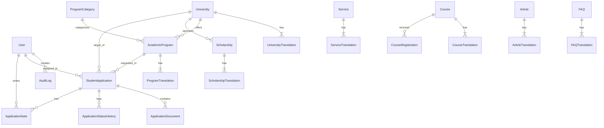

# Sora Education Platform — Database Architecture & Entity Specifications

## 1. Architectural Philosophy
The Sora Education Platform utilizes a strictly typed, relational database model managed via **Prisma ORM**. To ensure flawless multi-lingual scaling without sparse column anti-patterns, the system implements a **Normalized Translation Table Pattern** across all user-facing content entities.

Additionally, to respect student data privacy and compliance standards, student verification documents (e.g., passports, transcripts) are strictly decoupled from public marketing media assets.

---

## 2. Core Entities & Data Dictionary

### 2.1 Identity & Access Control
- **`User`**: System staff members, admissions counselors, and content editors.
  - Fields: `id`, `email`, `passwordHash` (bcrypt), `fullName`, `role` (`SUPER_ADMIN`, `ADMIN`, `ADMISSIONS_OFFICER`, `CONTENT_EDITOR`), `isActive`, `createdAt`, `updatedAt`.
- **`AuditLog`**: Immutable activity trail recording user ID, action, entity type, record ID, IP address, and payload details.

### 2.2 University & Academic Catalog
- **`University`**: Core institution entity.
  - Fields: `id`, `slug`, `type` (`FOUNDATION`, `PRIVATE`, `PUBLIC`), `city`, `establishedYear`, `campusType`, `ranking`, `websiteUrl`, `logoUrl`, `coverImageUrl`, `featured`, `published`.
- **`UniversityTranslation`**: Composite key (`universityId`, `lang` where `lang` in `['ar', 'tr', 'en']`).
  - Fields: `name`, `overview`, `admissionRequirements`, `accommodationInfo`, `accreditationInfo`, `address`.
- **`ProgramCategory`**: Broad discipline group (e.g. Medicine & Health, Engineering & AI, Architecture, Business & Economics).
- **`AcademicProgram`**: Specific degree course offered by a university.
  - Fields: `id`, `universityId`, `categoryId`, `slug`, `degreeLevel` (`BACHELOR`, `MASTER_WITH_THESIS`, `MASTER_NON_THESIS`, `PHD`, `ASSOCIATE`), `studyLanguage` (`TURKISH`, `ENGLISH`, `MIXED`, `ARABIC`), `durationYears`, `annualTuition`, `discountedTuition`, `currency`, `academicYear`, `applicationStatus`, `published`.
- **`ProgramTranslation`**: Composite key (`programId`, `lang`).
  - Fields: `name`, `facultyName`, `description`, `requirements`, `careerOpportunities`.

### 2.3 Student Admissions Pipeline
- **`StudentApplication`**: Core dossier submitted by a prospective student.
  - Fields: `id`, `applicantName`, `email`, `phone`, `nationality`, `passportNumber`, `birthDate`, `gender`, `currentCountry`, `address`, `highSchoolGpa`, `graduationYear`, `preferredLanguage`, `degreeLevel`, `desiredMajor`, `universityId`, `programId`, `status` (`SUBMITTED`, `UNDER_REVIEW`, `DOCUMENTS_PENDING`, `SUBMITTED_TO_UNIVERSITY`, `ACCEPTED`, `REJECTED`, `ENROLLED`), `assignedToId`.
- **`ApplicationDocument`**: Verification records uploaded by the student.
  - Fields: `id`, `applicationId`, `documentType` (`PASSPORT`, `HIGH_SCHOOL_DIPLOMA`, `TRANSCRIPT`, `LANGUAGE_CERTIFICATE`, `PHOTO`, `OTHER`), `filePath`, `originalName`, `mimeType`, `fileSize`.
  - **Storage Rule**: Files are saved in a protected server directory (`uploads/private/applications/`) and streamed only via authenticated endpoints with ownership checks.
- **`ApplicationStatusHistory`**: Timestamped ledger tracking state transitions and counselor explanations.
- **`ApplicationNote`**: Internal team collaboration notes attached to a student file.

### 2.4 Educational Products & Content
- **`Service` & `ServiceTranslation`**: Student consulting packages, visa guidance, and housing services.
- **`Course` & `CourseTranslation`**: Exam preparation courses (YÖS, TÖMER, SAT, IELTS) with schedules, capacity, and `CourseRegistration` records.
- **`Scholarship` & `ScholarshipTranslation`**: Discount quotas, eligibility criteria, and deadlines.
- **`Article` & `ArticleTranslation`**: Blog posts, student living guides, and SEO meta descriptions.
- **`FAQ` & `FAQTranslation`**: Categorized student inquiries and answers.
- **`Testimonial`**: Real admitted student reviews with university and major attribution.
- **`PageSection`**: Visual CMS sections with dynamic ordering and multilingual copy.
- **`MediaAsset`**: Public media gallery with multilingual alt tags.
- **`SiteSetting`**: Key-value configuration for WhatsApp routing, contact channels, and branding.

---

## 3. Database Schema Diagram (ERD Overview)

---

## 4. Multi-Environment Schema Support

The platform includes two production-tested schema definitions:

1. **Local Development & Automated Tests (`schema.prisma`):**
   - Configured with `provider = "sqlite"` to ensure 100% zero-dependency local execution on any developer machine without requiring background database services.
2. **Production Enterprise (`schema.postgresql.prisma`):**
   - Configured with `provider = "postgresql"` for robust clustering, connection pooling (PgBouncer), native UUID generation, and high-concurrency write throughput.
